# AGSG, Self-Driving Vehicle (WRO Future Engineers 2026)

**Team:** AGSG (Portugal), Joana Silva, Simão Freire · **Coach:** Tiago Severino

## The Team

### Joana Silva

**Age:** 19 · **University:** Faculdade de Medicina da Universidade de Lisboa, Lisboa, Portugal

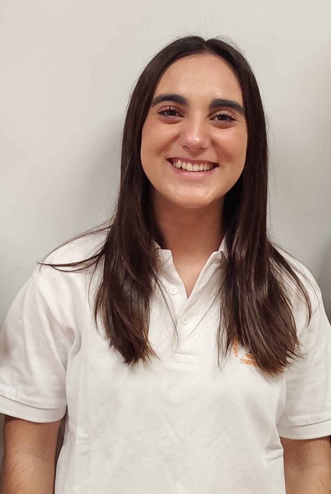

Hi, I'm Joana from Portugal and this is my fourth season of WRO. I've participated in this category before, but as I find it extremely challenging, there's always something to improve on. I've enjoyed challenges ever since I was little and this is another one that connects what I love: programming and robotics. My expertise in this team focuses on computer vision algorithms and sensor integration.

### Simão Freire

**Age:** 21 · **University:** Instituto Superior de Engenharia de Lisboa, Lisboa, Portugal

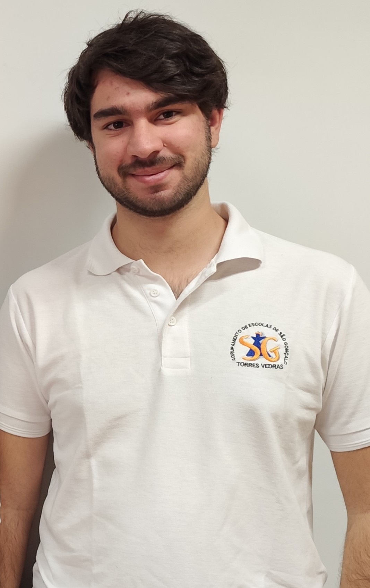

Hi! My name is Simão and ever since I was a kid, I've been interested in computers and how they work, that led me to the path of wanting to learn more about programming and so I joined the robotics club of my school. This will be my fourth season in WRO and I'm really looking forward to it! I specialize in embedded systems programming and mechanical design.

### Tiago Severino

I'm a hardworking, goal-oriented young man. Challenges captivate me and the harder they are, the better. Overcoming limits gives me a special taste, realizing how far I can go. I've already taken part in robotics competitions and now I'm leading a team with the aim of teaching what I've learned from my experience. I believe that the only way to get where you want to go is to never stop trying and never give up until you reach the end goal.

### Team photo

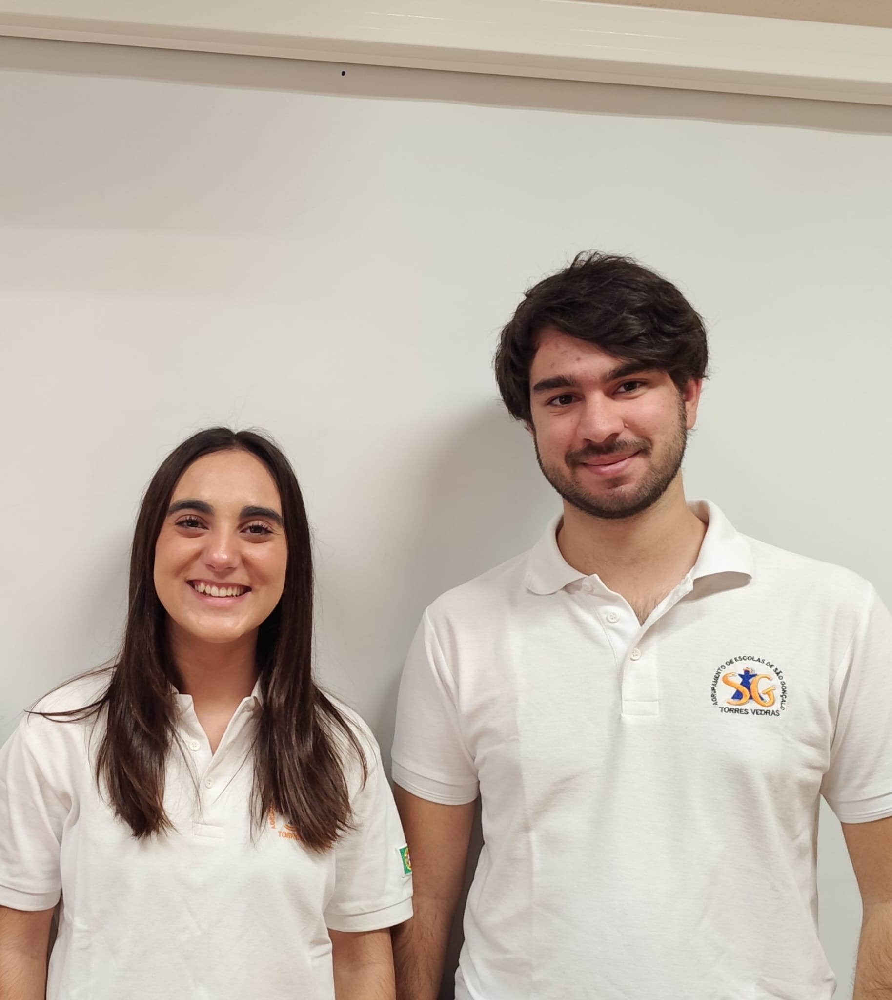

## Table of contents

1. [Introduction](#1-introduction)
2. [Vehicle Hardware](#2-vehicle-hardware)
3. [Software Architecture](#3-software-architecture)
4. [Simulator (firmware-in-the-loop)](#4-simulator-firmware-in-the-loop)
5. [Build and Upload](#5-build-and-upload)
6. [Repository Structure](#6-repository-structure)
7. [Reproducibility](#7-reproducibility)

---

## 1. Introduction

This repository contains the full engineering documentation and control software of our self-driving vehicle, developed for the **WRO Future Engineers** category in the **2026** season. The vehicle is a small **Ackermann-style car** that drives autonomously around the field, follows the outer lane, obeys traffic signs, avoids obstacles and parks itself.

The system is built around three programmable boards:

| Board | Purpose |
|-------|------|
| **Raspberry Pi Pico 2** (main) | Motor/servo control, odometry, IMU, navigation and decision logic |
| **Raspberry Pi Pico 1** (sonar slave) | Reads the four ultrasonic distance sensors and streams them over UART |
| **OpenMV H7 R1** (camera) | Detects the coloured traffic signs and streams the detections over UART |

All control software is written in **MicroPython**.

## 2. Vehicle Hardware

### 2.1 Components

| Component | Model / specification | Purpose |
|-----------|-----------------------|---------|
| Main controller | Raspberry Pi Pico 2 (RP2350) | navigation, control, sensor fusion |
| Sonar controller | Raspberry Pi Pico 1 (RP2040) | reads the 4 ultrasonic sensors |
| Camera | OpenMV H7 R1 | traffic-sign colour detection |
| Drive motor | N20 1000 RPM 12 V DC, with quadrature encoder | propulsion + odometry |
| Gear / differential | 3:5 reduction + metal RC differential gear set (Wltoys 144001 type) | rear axle, cornering |
| Motor driver | TB6612FNG H-bridge | motor speed and direction |
| Steering | Savox SH-0255 MG servo | Ackermann front steering |
| IMU | BNO085 | heading (game rotation vector) |
| Distance sensors | 4× SRF04 ultrasonic (front, rear, left, right) | wall/obstacle distance |
| Communication | HC-06 Bluetooth module | wireless telemetry for debugging only (TX only; removed during competition rounds) |
| Battery | 3× 18650 Li-ion in series (11.1 V, 1800 mAh) | power source |
| Regulators | LM2596 (buck), 2× L7805CV | power distribution |

### 2.2 Power Architecture

The battery (3× 18650 in series, ≈11.1 V) feeds three independent rails:

- **LM2596** buck converter → constant **11 V** → **TB6612FNG** (motor power).
- **L7805CV #1** → **5 V** → **steering servo**.
- **L7805CV #2** → **5 V** → both Picos, BNO085, HC-06, SRF04 sensors and the OpenMV camera.

The motor and the logic/sensor rails are separated so that motor current spikes do not disturb the sensitive electronics. The full pin-level wiring diagram is available in `schemes/`.

### 2.3 Dimensions and Mechanical Design

The vehicle measures **200 mm (length) × 61 mm (width) × 170 mm (height)** and weighs **610 g**, well inside the 1.5 kg limit (rule 11.2). We kept the footprint compact so that it manoeuvres easily around the field without hitting walls or obstacles.

The body stays **above** the walls and obstacles, so the vehicle clears low obstacles, and a **nose close to the ground** extends at the front. Following the rules that the walls are **100 mm** high (13.3) and the parking limitation is **200 × 20 × 100 mm** (13.25), the parking length is measured at the height below the wall: the nose is now **73 mm** long, which keeps the measured length short.

The drivetrain is a single rear **DC motor (N20, 1000 RPM) with a quadrature encoder**, driving the rear axle through a **3:5 gear reduction** and a **metal RC differential**, which lets the two rear wheels rotate at different speeds through corners. The front wheels use **Ackermann steering** driven by a single **servo**. The encoder provides odometry (distance travelled), and the BNO085 IMU provides heading, so the robot navigates with a closed-loop position estimate.

**Technical datasheet** (full PDF in [`models/robot_profile.pdf`](models/robot_profile.pdf)):

<div align="center">
    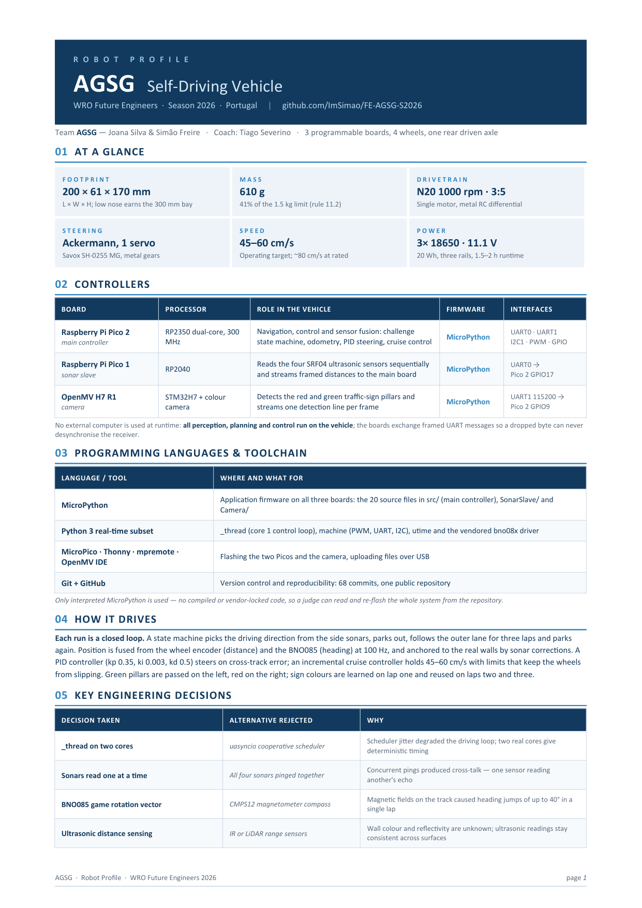
    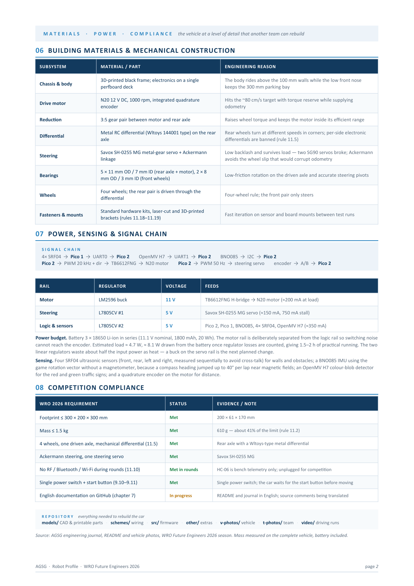
</div>

### 2.4 Vehicle photos

| Front | Back | Top |
|---|---|---|
| 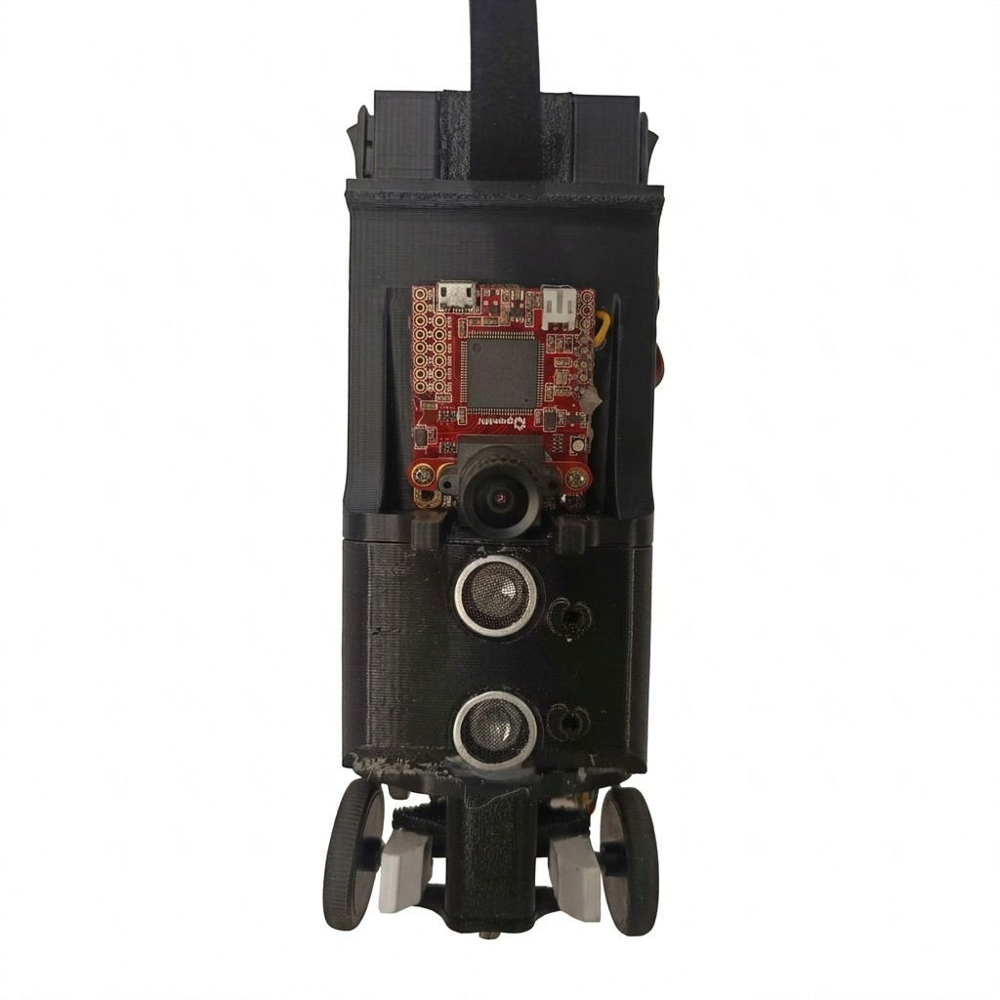 | 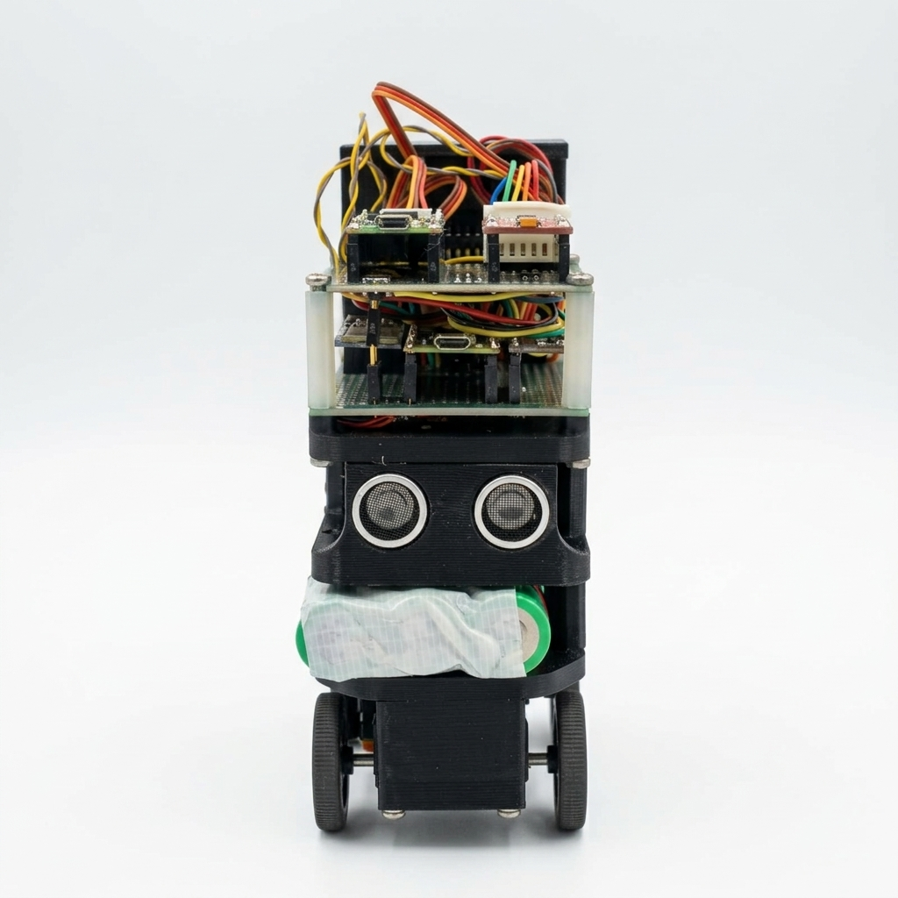 | 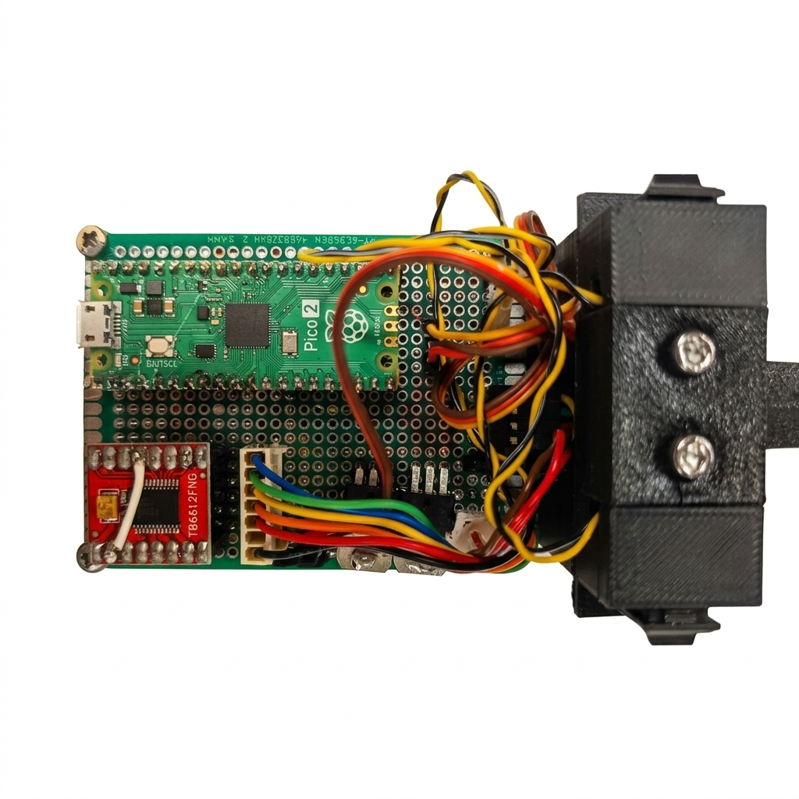 |

| Left | Right | Bottom |
|---|---|---|
| 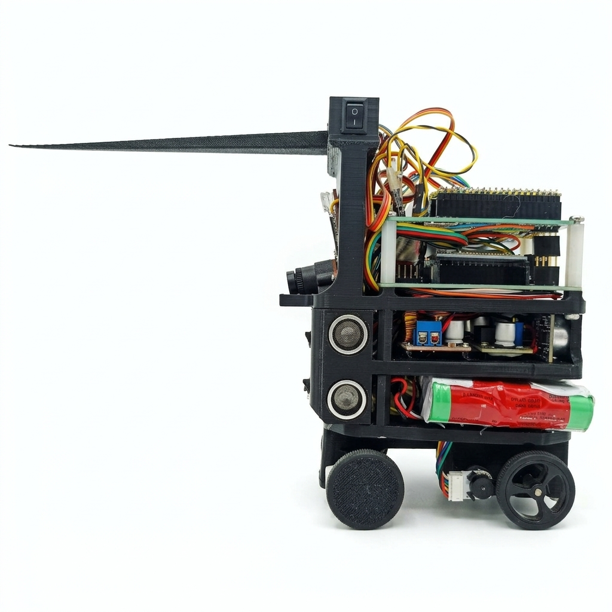 | 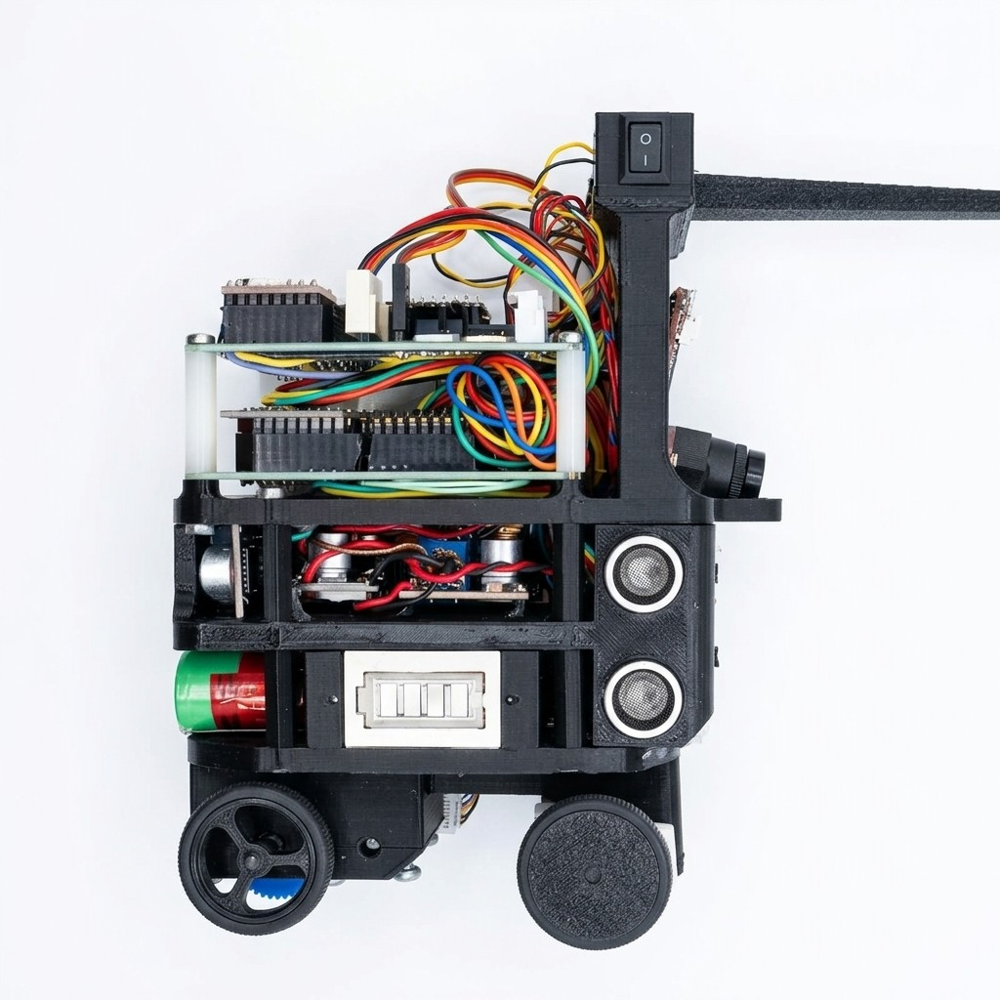 | 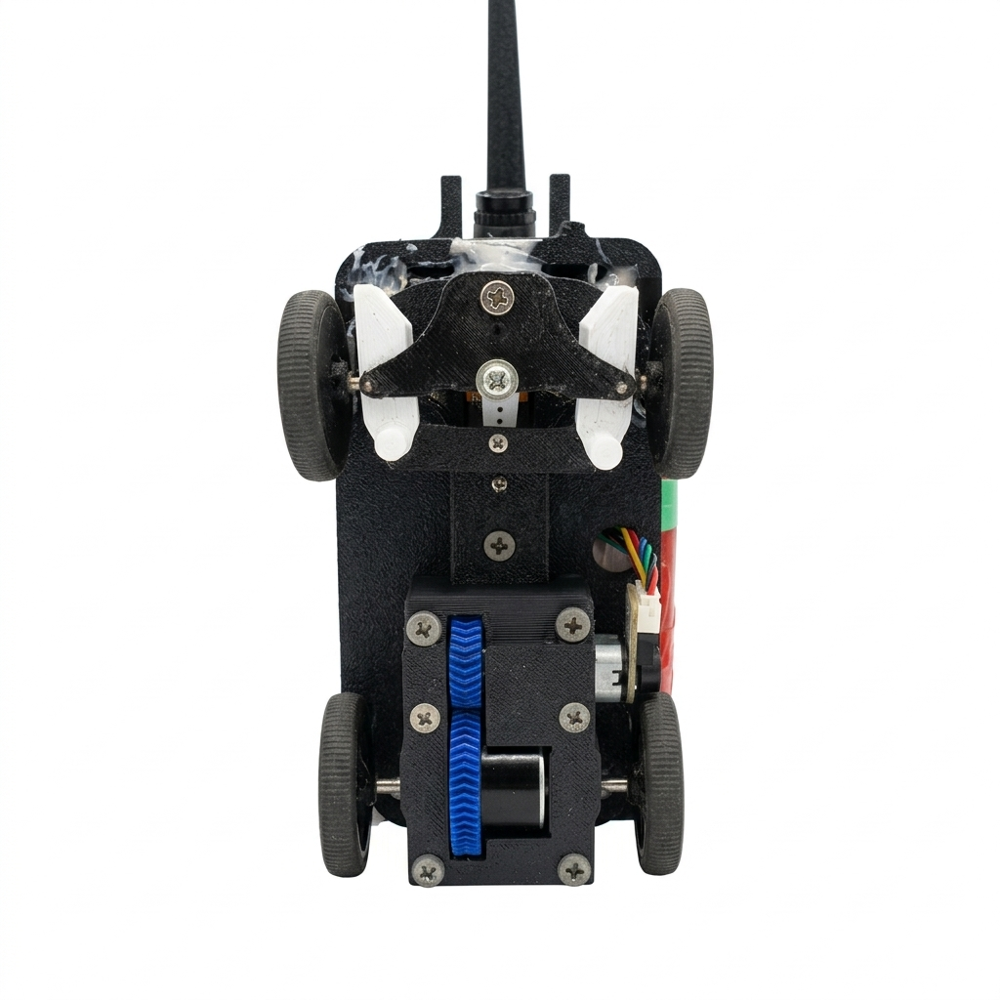 |

## 3. Software Architecture

### 3.1 Overview

The main controller (Pico 2) runs a real-time **background control loop on the second core** (MicroPython `_thread`), while the navigation state machine runs on the first core. The background loop continuously:

1. reads the distance sensors (over UART from the sonar slave),
2. reads the camera detections (over UART1 from the OpenMV),
3. integrates **odometry** (encoder distance + IMU heading),
4. runs the **cruise control** (motor speed regulation),
5. sends **telemetry** over Bluetooth,
6. applies **sonar-based odometry corrections**.

### 3.2 Main controller modules (`src/robot/`)

| Module | Responsibility | Related hardware |
|--------|----------------|------------------|
| `main.py` | Entry point; runs the obstacle challenge | |
| `init.py` | Hardware init (300 MHz clock, UARTs, camera, servo); starts the background thread | all |
| `obstacle_challenge.py` | The challenge **state machine** (parking, lanes, traffic signs, obstacles) | all |
| `move_coordinates.py` | Navigation primitives: `move_coordinates`, `rotate_angle`, `rotate_coordinates` (odometry + PID steering) | motor, servo, encoder, IMU |
| `background.py` | Background control loop (sensors, odometry, cruise control, telemetry) | sonar, camera, encoder, IMU, motor |
| `state.py` | Shared robot state (odometry, lane, direction) | |
| `ekf.py` | Extended Kalman filter (EKF) for pose estimation: encoder predict + sonar update | encoder, IMU, sonar |
| `field.py` | Field model (4 lanes, 3 zones, traffic-signal tracking) | |
| `camera.py` | Parses OpenMV traffic-sign detections (UART1) | OpenMV |
| `distance.py` | Parses sonar distance over a framed protocol (header 0xA5 + XOR checksum) | sonar slave |
| `encoder.py` | Quadrature encoder with dynamic debounce | encoder |
| `motor.py` | Motor PWM and direction (20 kHz) | TB6612FNG |
| `servo.py` | Steering servo (50 Hz PWM) | servo |
| `compass.py` | BNO085 heading (game rotation vector, no magnetometer) | BNO085 |
| `bno08x.py` | BNO08x driver library | BNO085 |
| `pid.py` | Generic PID controller (used for steering) | |
| `telemetry.py` | Telemetry frame (CSV + XOR checksum) over UART → Bluetooth | HC-06 |
| `uart.py` | Shared UART helper | |

### 3.3 Sonar slave (`src/robot/SonarSlave/`)

The sonar slave (Pico 1) reads the four SRF04 ultrasonic sensors and transmits the four distances over UART0 using a framed protocol (header byte `0xA5`, four little-endian `uint16` values scaled by 10, and an XOR checksum). This framing lets the receiver re-synchronise if a byte is ever lost.

### 3.4 Camera (`src/robot/Camera/`)

The OpenMV H7 runs a colour-blob detector, converts each blob to the sign's position and height in centimetres, and streams `CAM:x,y,h,COLOR` lines over UART (x lateral + right, y forward, h sign height). The main controller turns each detection into an absolute field position and matches it to the nearest known sign position within 5 cm.

### 3.5 Concurrency and real-time control

The vehicle uses **two cores** of the main Pico:

- **Core 0** runs the navigation state machine (`obstacle_challenge`), which sets target speed/steering and reads the position estimate.
- **Core 1** runs the `background` loop, which reads sensors at fixed rates (distance 50 Hz, camera 50 Hz, odometry 100 Hz, speed control 10 Hz) and drives the motor PWM through the cruise controller.

The cruise controller is an incremental speed controller with acceleration/deceleration limits, and the steering uses a **PID** controller on the cross-track error. The encoder uses a **dynamic debounce** whose window scales with the current speed, and the motor runs at **20 kHz PWM** so switching noise stays above the encoder band.

### 3.6 How the robot drives

The control is a closed loop. The state machine (`obstacle_challenge`) sets a target speed and target heading; the background loop continuously integrates odometry, distance from the encoder (`counts / (PPR / gear ratio) × wheel circumference`) and heading from the BNO085 IMU, and a **PID** controller steers toward the target heading while the **cruise controller** regulates motor speed with acceleration and deceleration limits. The sonars (distance) and the camera (traffic signs) feed events back to the state machine, which switches state whenever a milestone is reached (a wall ahead, a traffic sign, or the parking spot).

### 3.7 Lane following and traffic-sign logic

The obstacle challenge is a **three-lap** run around a track whose lanes are separated by traffic signs placed on the inner wall. Each sign is either **green** (the robot must pass on its **left**) or **red** (the robot must pass on its **right**). The state machine in `obstacle_challenge.py` drives each lane in three phases:

1. **Entry**, before entering a corridor the robot first reads the **entry traffic sign** so it enters on the correct side (`Field.can_enter_lane()`). If the sign is not visible yet, it drives toward the camera position and keeps searching in one continuous move until the colour is confirmed (`stop_when=Field.can_enter_lane`).
2. **Corridor**, halfway along the corridor it re-reads the **exit traffic sign** (`Field.can_exit_lane()`). Depending on the colour it either crosses from the right side to the left (or vice-versa) or stays on the same side until the end of the corridor.
3. **Next lane**, the side to take is returned by `Field.lanes_sides()`, and the lane offset (`get_traffic_lane_y()`) is computed from that side, so the trajectory adjusts to the traffic sign.

The **first lap is used to detect and memorise** the colour of every sign. The second and third laps read the colours from the memorised `Field` model and go straight to the correct side without stopping to re-detect, which saves time.

### 3.8 Confirming a traffic sign (field-of-view time)

A sign position is never trusted the moment the camera first sees it: the robot keeps looking until it is sure of the colour, or until it is sure that there is no sign there at all. `camera.py` accumulates how long each sign position stays inside the camera's field of view (`_accumulate_pov_time()`), and `field.py` only treats a still-unknown position as **effectively empty** once it has been observed for at least `ZONE_POV_THRESHOLD_MS` (2 s). This confirms the sign really stayed in view long enough to rule out a missed detection, instead of mistaking "not seen yet" for "no sign".

### 3.9 Motion control, safety and odometry correction

- **No skidding.** The cruise controller applies acceleration/deceleration limits and holds the brake for `REVERSE_HOLD_MS` (500 ms) before reversing direction, because a skidding wheel makes the encoder count wheel spin that does not translate into travel, which corrupts the odometry.
- **Servo limits.** Steering is clamped to ±`_MAX_STEERING_OFFSET` (29°), and the cruise controller reduces its acceleration while the wheels are steered (the `accel_scale` term), so the servo is never forced and the tyres do not scrub in corners.
- **Odometry, Extended Kalman filter.** The pose is estimated by an EKF (`ekf.py`): the encoder integration is the *predict* step, and the sonar readings at known locations (`correct_corridor()` in a straight corridor, `correct_corner()` in the corners) are the *update* step. Each sonar fix is gated per axis with a Mahalanobis distance (3σ), so an outlier never pulls the estimate.
- **Timeouts.** Every rotation and movement has a timeout, `ROTATE_TIMEOUT_MS` (8 s), `MOVE_TIMEOUT_MS` (60 s), a 3 s wait for the exit sign, and 5 s / 10 s parking loops, so a missed detection or a sensor glitch can never stall the robot forever.

The steering PID gains (`kp=0.35`, `ki=0.003`, `kd=0.5`) were tuned with the help of this guide: <https://youtu.be/4Y7zG48uHRo>.

### 3.10 Surprise Rule (modified traffic sign)

The optional **Surprise Rule** replaces one traffic sign with the **opposite colour** and a random height of **50 mm or 150 mm** (instead of 100 mm). The vehicle must pass on the side of the **original** colour, so the visible colour is misleading.

The camera measures the sign height, and the controller **inverts the colour** when the height is 5 or 15 cm; a 10 cm sign is normal. The inversion is decided per passage, and each correct passage of the modified sign scores **5 points**, up to **15**.

## 4. Simulator (firmware-in-the-loop)

To validate the navigation code without burning track time, we built a **firmware-in-the-loop simulator**. A browser UI owns the world (arena, walls, traffic signs, parking bay and Ackermann physics), while a Python process runs the **exact MicroPython firmware** from `src/robot/` under CPython through a small hardware shim that emulates the sonar frames, camera lines, encoder pulses and IMU heading. A change to `src/robot/` changes the next simulated round with no porting step: the same `obstacle_challenge()` state machine that drives the virtual car drives the real one.

The simulator is used to:

- **Score every change**, each round is timed and scored with the official WRO FE 2026 table (max 62). The seed fixes both the sign layout and the start direction, so two firmware versions are compared on the exact same track.
- **Measure fidelity as a number**, the firmware's own odometry is compared with the world's true pose every frame; the measured error is **2–8 cm over an 8 m run**, which is how we know the units, signs and frames are correct.
- **Sweep sign layouts**, `src/simulator/tools/sign_sweep.py` runs one round per sign pattern (53 layouts) to find cases the firmware cannot handle (40/53 currently score 62).
- **Report safety margins**, `src/simulator/tools/margin_report.py` rebuilds the car body at every trajectory step and reports the clearance to each wall and sign.
- **Audit MicroPython portability**, `src/simulator/tools/mpy_audit.py` flags CPython-only stdlib calls (`os.environ`, `math.hypot`) that import fine in the simulator but crash on the board.
- **Run headless**, `python -m simulator.race_run --runs N` runs N rounds unattended and leaves the score breakdown and a screenshot, so a firmware change is judged by its score, not by hand.

Bench calibration (`src/simulator/calibrate.py` + `src/robot/bench/bench_turn_radius.py`) closes the loop between sim and car: by driving fixed servo angles on the floor and measuring the turn radius, we fit the real steering gain and offset and feed them back into the simulator.

Full details and current measured results: [`src/simulator/README.md`](src/simulator/README.md).

## 5. Build and Upload

All firmware is flashed with **MicroPython**:

1. Flash MicroPython onto the Pico 2 (main) and Pico 1 (sonar slave).
2. Upload the files in `src/robot/` to the **Pico 2** (using the MicroPico VS Code extension, Thonny, or `mpremote`). `main.py` is the entry point.
3. Upload the contents of `src/robot/SonarSlave/` to the **Pico 1** (`main.py` runs the sonar loop).
4. Flash the OpenMV firmware in `src/robot/Camera/main.py` onto the **OpenMV H7**.
5. Power on: the main controller runs `main.py` automatically and starts the obstacle challenge.

The only external dependency is the `bno08x.py` driver, which is included in the repository.

## 6. Repository Structure

```
├── models/          # CAD / 3D-printable and CNC files
├── other/           # extra files (hardware specs, upload notes, datasets)
├── schemes/         # wiring diagrams (electromechanical)
├── src/             # all control software
│   ├── robot/       # vehicle firmware (MicroPython)
│   │   ├── SonarSlave/   # sonar controller firmware
│   │   ├── Camera/       # OpenMV camera firmware
│   │   ├── bench/        # bench calibration scripts
│   │   ├── patches/      # documented firmware patches
│   │   ├── hc05/         # HC-05 Bluetooth setup
│   │   └── sync_firmware.sh  # refresh the vendored firmware
│   └── simulator/   # Python simulator (firmware-in-the-loop)
│       ├── ui/      # browser UI (physics + scoring)
│       ├── tools/   # sign sweep / margin report / MicroPython audit
│       ├── start.sh # start the simulator
│       └── start_ui.py  # start the UI
├── t-photos/        # team photos
├── v-photos/        # vehicle photos (all sides, top, bottom)
└── video/           # link to the driving-demonstration video
```

## 7. Reproducibility

To reproduce this vehicle, another team needs the hardware listed in §2.1, the wiring diagram in `schemes/`, the CAD files in `models/`, and the source code in `src/robot/`. The README and code comments document the module responsibilities and the build/upload process, so the robot can be rebuilt and the software re-flashed from this repository alone.
