# AGSG — Engineering Journal
## WRO Future Engineers 2026 — Self-Driving Car

**Team:** AGSG (Portugal) — Joana Silva, Simão Freire
**Coach:** Tiago Severino
**Version:** 1.0.0 · **Date:** 2026-11-11 · **Commit:** `93a9142`

---

## Table of contents

1. [Introduction](#1-introduction)
2. [Mobility & Mechanical Design](#2-mobility--mechanical-design)
   - [2.1 Chassis and dimensions](#21-chassis-and-dimensions)
   - [2.2 Drive train](#22-drive-train)
   - [2.3 Steering](#23-steering)
   - [2.4 Motor selection and speed reasoning](#24-motor-selection-and-speed-reasoning)
   - [2.5 Suspension](#25-suspension)
3. [Power & Sensor Architecture](#3-power--sensor-architecture)
   - [3.1 Power distribution](#31-power-distribution)
   - [3.2 Power budget](#32-power-budget)
   - [3.3 Sensors](#33-sensors--selection-and-placement)
   - [3.4 Calibration](#34-calibration)
   - [3.5 Gyro evaluation](#35-gyro-evaluation)
4. [Software Architecture & Obstacle Strategy](#4-software-architecture--obstacle-strategy)
   - [4.1 Overview](#41-overview--three-boards)
   - [4.2 Modules](#42-main-controller--modules)
   - [4.3 Concurrency](#43-concurrency--two-cores)
   - [4.4 State machine](#44-state-machine-obstacle-challenge)
   - [4.5 Field model](#45-field-model)
   - [4.6 Navigation and control](#46-navigation-and-control)
   - [4.7 Traffic-sign detection and passing](#47-traffic-sign-detection-and-passing)
   - [4.8 Noise handling](#48-noise-handling)
   - [4.9 Testing, tuning and validation](#49-testing-tuning-and-validation)
   - [4.10 Simulator (firmware-in-the-loop)](#410-simulator-firmware-in-the-loop)
   - [4.11 Edge cases](#411-edge-cases)
5. [Systems Thinking & Engineering Decisions](#5-systems-thinking--engineering-decisions)
   - [5.1 Constraints](#51-constraints)
   - [5.2 Key trade-offs and decisions](#52-key-trade-offs-and-decisions)
   - [5.3 Iteration history](#53-iteration-history)
   - [5.4 Risk & failure analysis](#54-risk--failure-analysis)
6. [Reproducibility & GitHub](#6-reproducibility--github)
7. [To be completed](#7-to-be-completed)

---

## 1. Introduction

This journal documents the engineering process behind our self-driving vehicle for the WRO Future Engineers 2026 season. It explains not only *what* we built, but *why* we made each decision, the constraints we worked under, the trade-offs we faced, and the iterations that led to the final design.

The vehicle is a compact **Ackermann-steering car** with a single rear **DC motor**, a front **servo**, and a sensor set composed of an **IMU**, four **ultrasonic sensors**, and a **camera**. It navigates the field autonomously, follows lanes, obeys traffic signs, avoids obstacles and parks itself.

The control software runs on **three programmable boards**: a Raspberry Pi Pico 2 (main controller), a Raspberry Pi Pico 1 (sonar controller) and an OpenMV H7 (camera), all programmed in **MicroPython**.

<div align="center">
    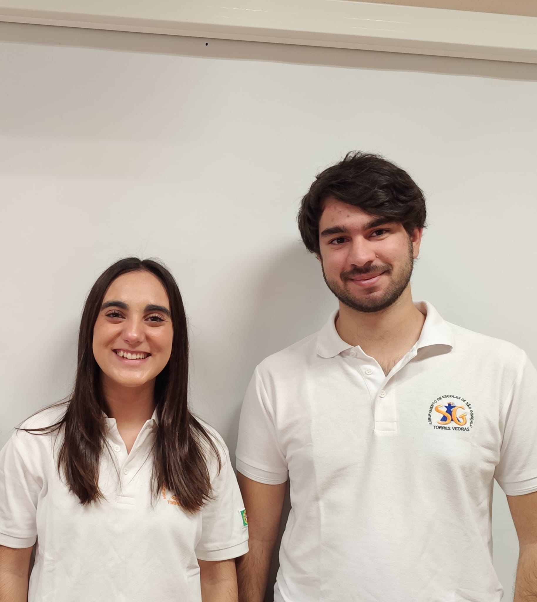
</div>

<div align="center">
    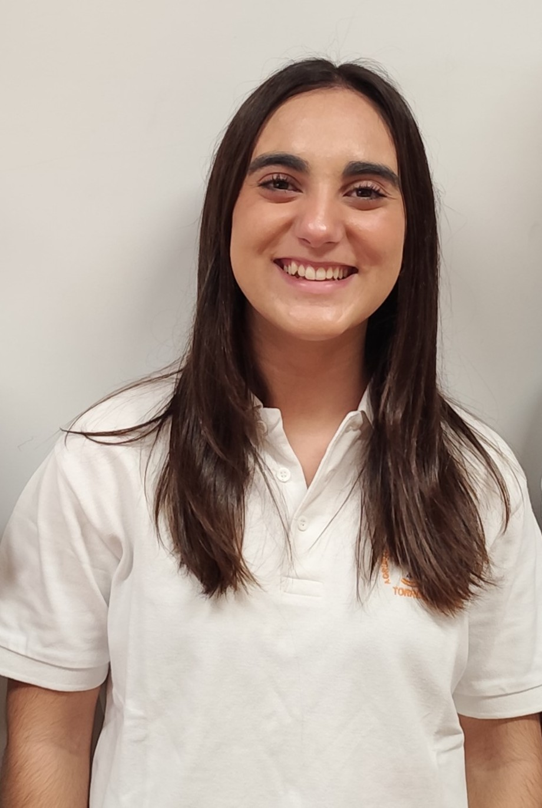
    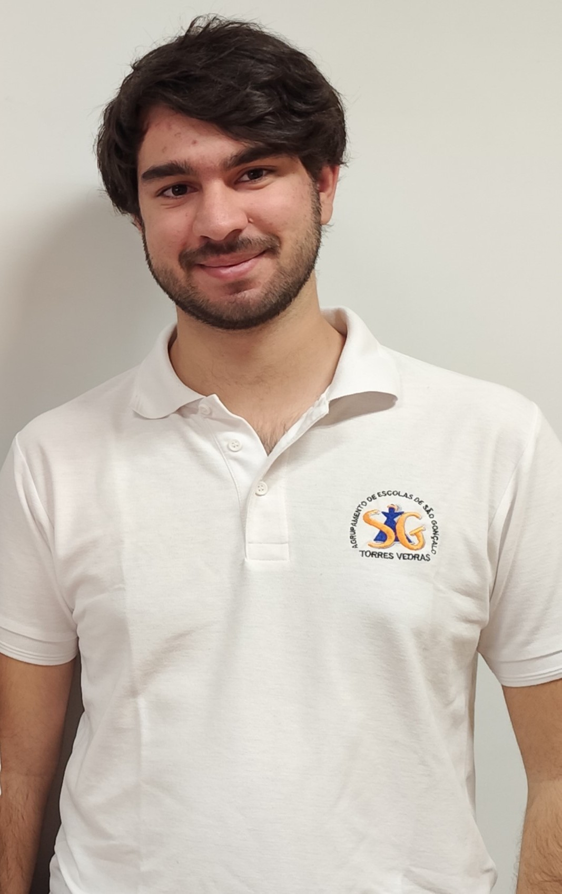
</div>

---

## 2. Mobility & Mechanical Design

### 2.1 Chassis and dimensions

The vehicle measures **200 mm (length) × 61 mm (width) × 170 mm (height)** and weighs **610 g**. We aimed for the smallest practical footprint so the robot manoeuvres easily between the walls and obstacles.

The body stays **above** the height of the field walls (100 mm), so it clears low obstacles without touching them, and a **nose close to the ground** extends at the front. Following the rules that the track walls are **100 mm** high (13.3) and the parking-lot limitations are **200 × 20 × 100 mm** (13.25), the parking length is measured at the height below the wall: this nose is kept low and is now **73 mm** long, so the vehicle's measured length at that height stays inside the parking bay. The rest of the body stays above wall level, so the vehicle still clears low obstacles.

**Mass:** the complete vehicle — 3D-printed frame, electronics, battery and motors — weighs **610 g**, about 41 % of the 1.5 kg limit (rule 11.2). That margin leaves room for planned additions such as replacing the two linear regulators with a buck converter, and it keeps the load on the single N20 drive motor and on the steering servo low. The frame is 3D-printed and the electronics sit on a single perfboard deck, which keeps the structure light and easy to modify between test runs.

**Material and stiffness.** The frame is printed in two materials. The **nose and the front suspension are TPU-GF** (glass-fibre-reinforced TPU): the nose has to bend, not snap, when it touches a wall, and the suspension struts have to flex and return — a rigid plastic would crack on the first hit. **Everything else is ASA**, chosen for stiffness and heat resistance: the motor mount, the axle blocks and the gearbox housing hold the 3:5 gear mesh at its measured **0.2 mm backlash** under the N20's torque instead of flexing and letting the gears skip, and the ASA body stays rigid at 610 g with the servo at full lock.

**Vehicle views:**

<div align="center">
    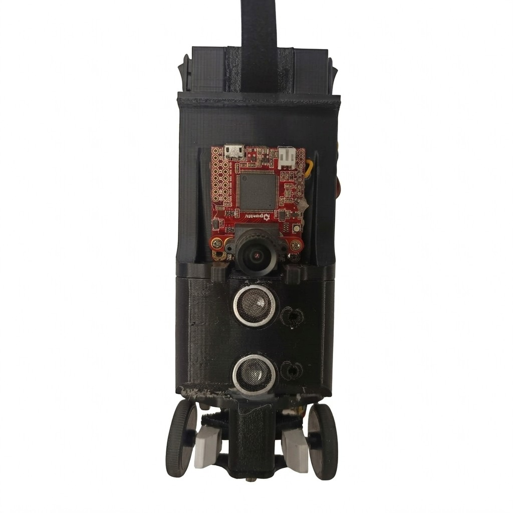
    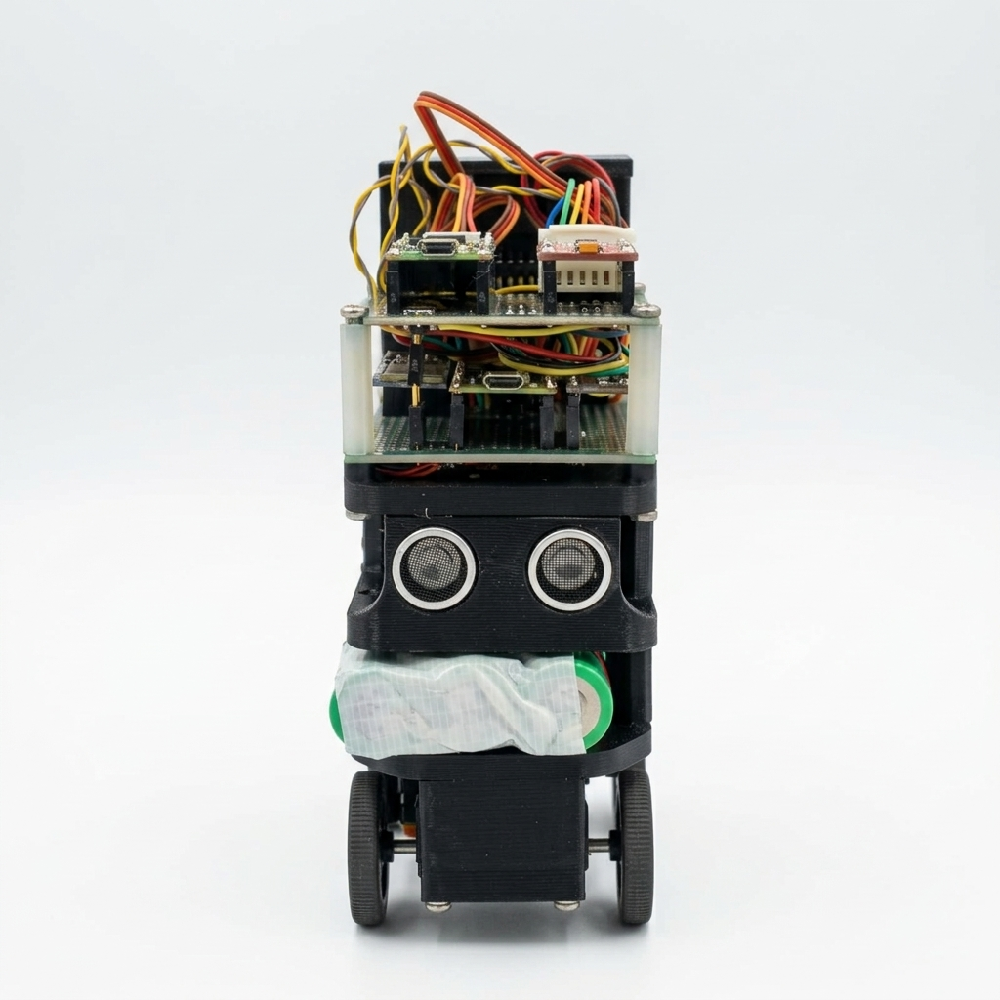
    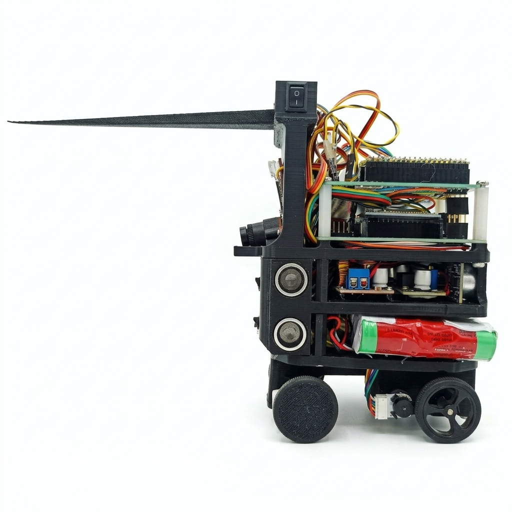
</div>
<div align="center">
    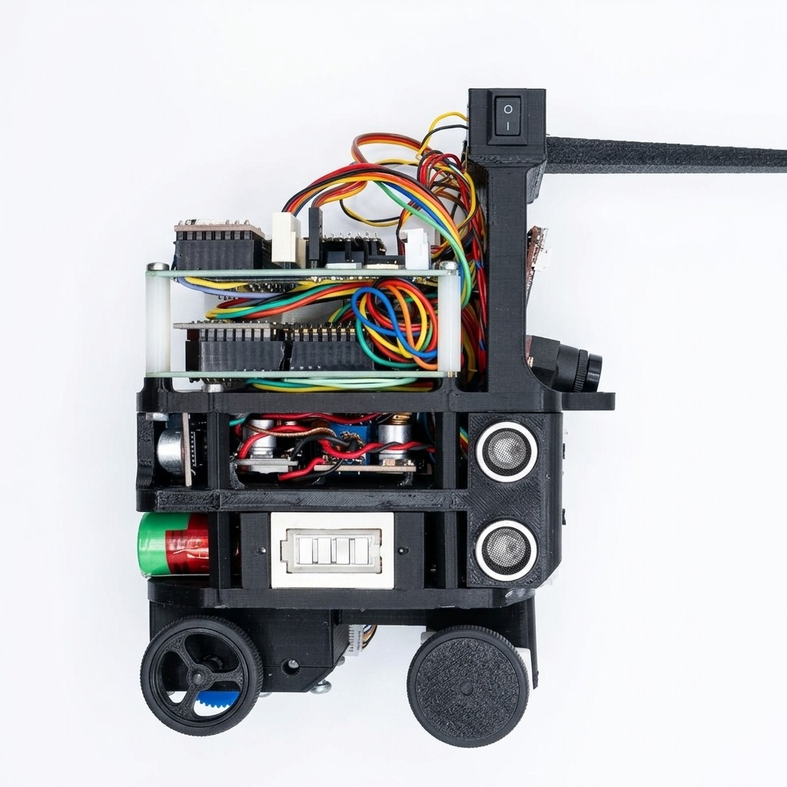
    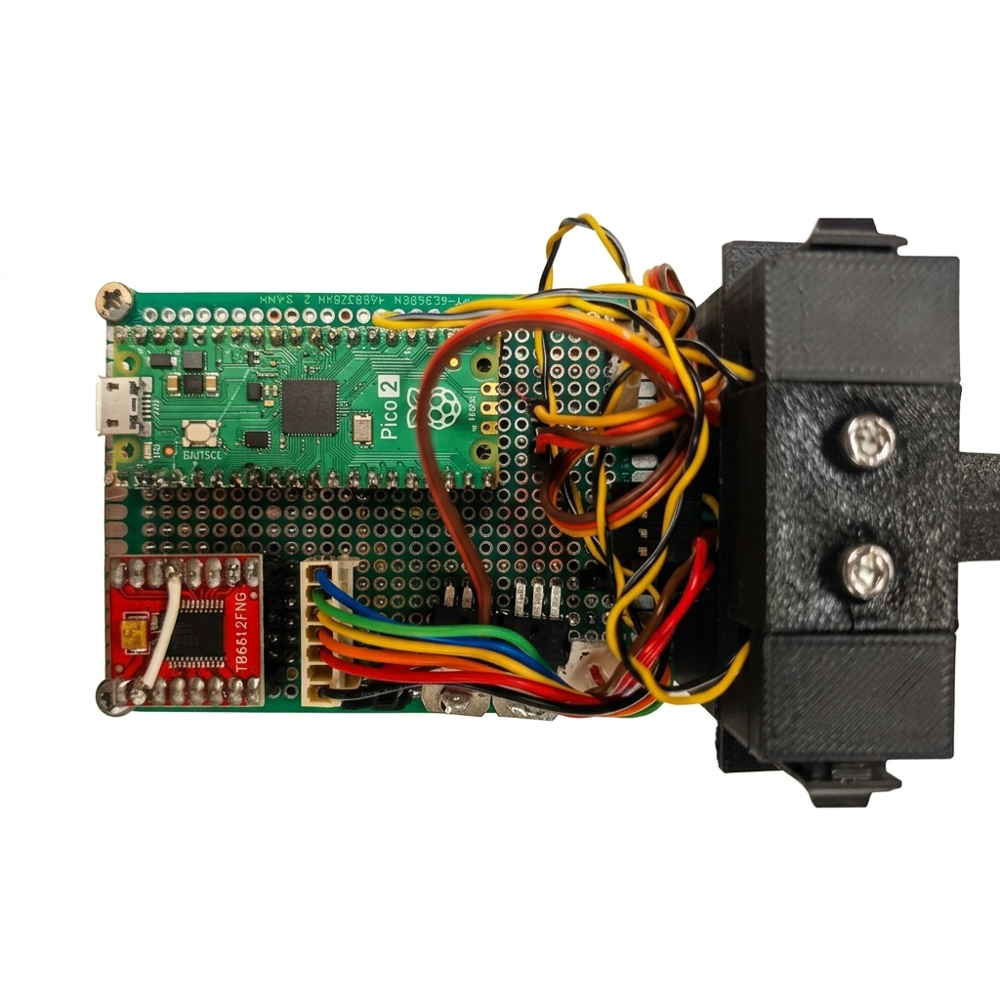
    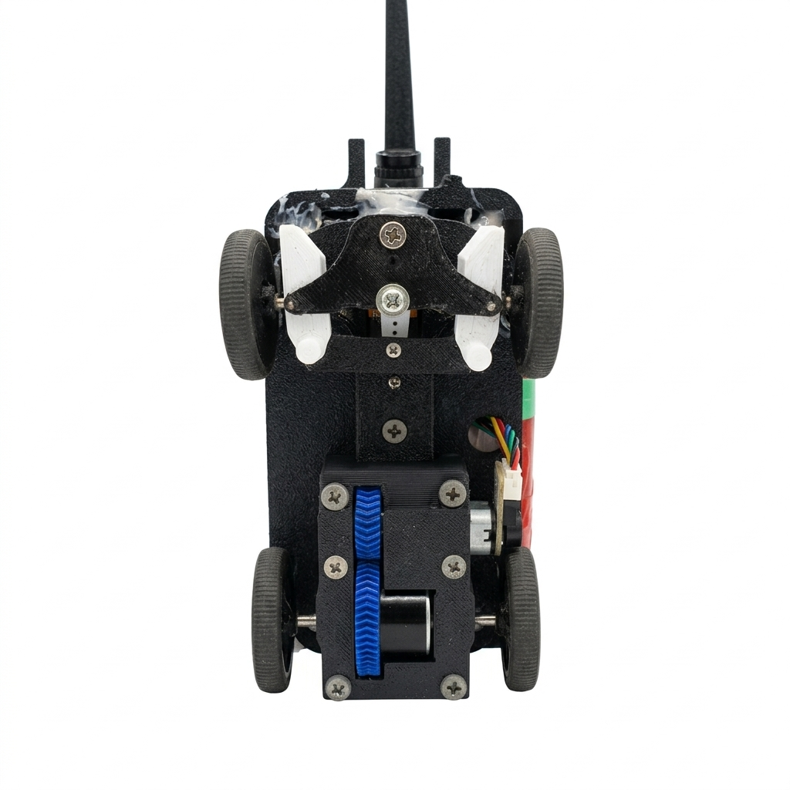
</div>

### 2.2 Drive train

The drivetrain is built from:

| Element | Choice | Reasoning |
|---------|--------|-----------|
| Drive motor | **N20 DC motor, 1000 RPM @ 12 V, with quadrature encoder** | compact, geared, encoder for odometry |
| Gear reduction | **3:5** (wheel turns 3/5 of the motor speed) | increases torque at the wheel while keeping the motor in its efficient range |
| Differential | **Metal RC differential (Wltoys 144001 type)** | lets the two rear wheels rotate at different speeds through corners |
| Rear axle | driven by the differential | — |

**Design parameters** (from the CAD model in `models/`):

| Parameter | Value | Notes |
|---|---|---|
| Motor gear PCD | 16.2 mm | pitch circle diameter |
| Housing gear PCD | 27 mm | pitch circle diameter |
| Gear teeth | 30 (motor) / 50 (housing) | 3:5 ratio (wheel turns 3/5 of the motor) |
| Gear backlash | 0.2 mm | |
| Gear thickness | 5 mm | |
| Axle width | 61 mm | measured |
| Wheel diameter | 32 mm | used in odometry (33.2 counts/cm) |
| Wheel width | 9 mm | |
| Wheelbase | 70 mm | steering radius R = L / tan(δ) |
| Steering arm offset | 10 mm | |

**Full CAD model** — the complete design (parts and assemblies) is available in the [Onshape document](https://cad.onshape.com/documents/e064973258882f3797ca66b3/w/e97523327652e311225f2991/e/db3f49a87a84e425faee13c2). The robot's side profile with dimensions is in [`models/robot_profile.pdf`](models/robot_profile.pdf).

**Bearings:**

| Location | Count | OD | Width | ID |
|----------|------|-----|-------|-----|
| Rear axle | 2 | 11 mm | 4 mm | 7 mm |
| Rear axle | 2 | 11 mm | 3 mm | 7 mm |
| Motor | 1 | 11 mm | 3 mm | 7 mm |
| Front wheels | 2 | 8 mm | 4 mm | 3 mm |

**Rear axle** (driven by the differential, with its two bearings):

<div align="center">
    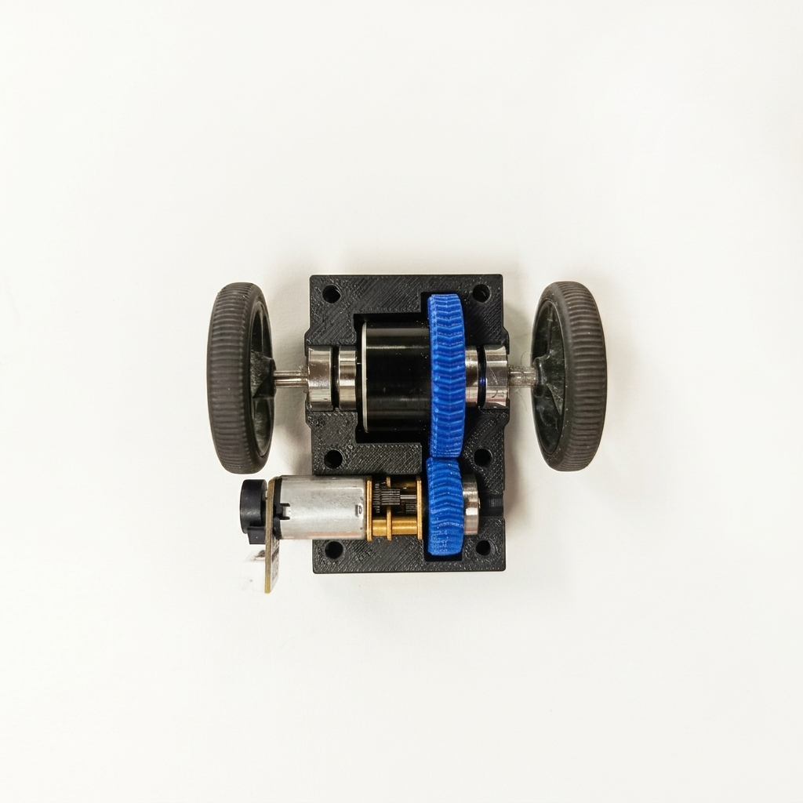
</div>

### 2.3 Steering

The front wheels use **Ackermann steering geometry**, driven by a single **Savox SH-0255 MG servo**. We chose this servo for its metal gears and low play (backlash): a micro 9g SG90 servo (both plastic and metal-gear versions) broke under load, while the Savox has held up reliably. Ackermann geometry makes the inner wheel turn more sharply than the outer wheel in a corner, so the wheels roll without slipping — this is important because our odometry assumes the wheels do not slip.

**Front axle** (Ackermann steering and pivots):

<div align="center">
    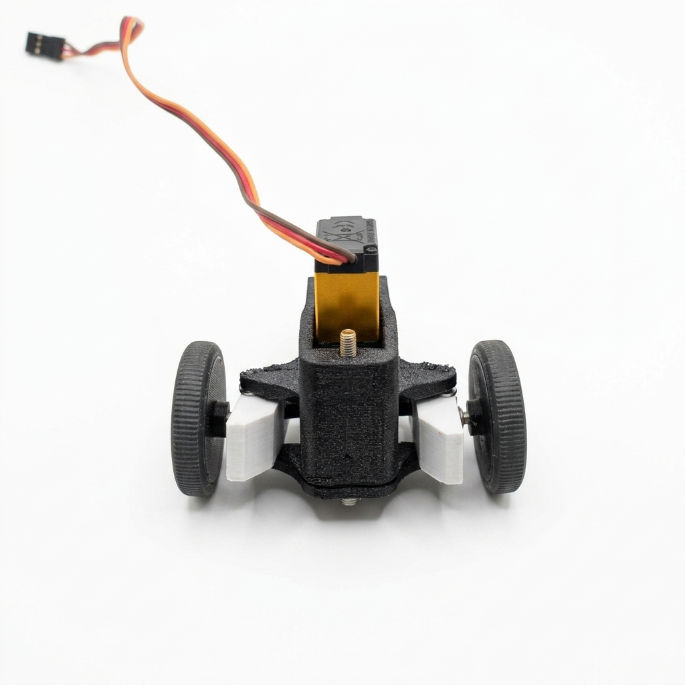
</div>

### 2.4 Motor selection and speed reasoning

**Requirement:** a small motor with an encoder, enough torque, and a maximum speed of about **80 cm/s**.

We compared the N20 motor family (12 V) at different gearbox ratios:

| Reduction ratio | No-load speed (RPM) | Rated speed (RPM) | Max torque (kg·cm) | Wheel speed at rated (cm/s) |
|----------------:|--------------------:|------------------:|-------------------:|----------------------------:|
| 10 (3000 RPM) | 3000 | 2300 | 0.20 | ~231 |
| 30 (1000 RPM) | 1000 | 770 | 0.48 | ~77 |
| 50 (600 RPM) | 600 | 460 | 0.80 | ~46 |

The **3000 RPM** version is far too fast (and has the lowest torque), while the **600 RPM** version is too slow. The **1000 RPM** version hits the ~80 cm/s target (≈77 cm/s at rated speed) with enough torque reserve.

With the 3:5 external reduction, the wheel speed is:

```
wheel RPM = motor RPM × (3/5)
wheel speed (cm/s) = wheel RPM × π × 3.2 cm / 60
```

At rated speed the 1000 RPM motor gives ~77 cm/s at the wheel; no-load gives ~100 cm/s. We run at a target speed of **45–60 cm/s**, below the rated speed, so the motor keeps torque reserve for acceleration and the wheels do not slip.

**Measured currents (N20 1000 RPM):** no-load 75 mA, load 0.3 A, stall 0.9 A.

### 2.5 Suspension

The front axle has a 3D-printed suspension (struts, pivots and axle sleeves — see `models/`) that keeps the front wheels in contact with the track; the rear axle is fixed. The animation below demonstrates how the front suspension moves:

<div align="center">
    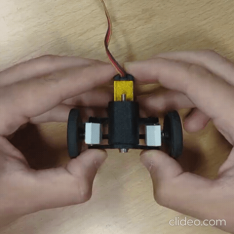
</div>

---

## 3. Power & Sensor Architecture

### 3.1 Power distribution

The battery is **3× 18650 Li-ion cells in series (11.1 V nominal, 1800 mAh)**. We split the power into three rails so that the noisy motor does not disturb the sensitive electronics:

| Rail | Regulator | Voltage | Feeds |
|------|-----------|---------|-------|
| Motor | LM2596 (buck) | 11 V | TB6612FNG → motor |
| Servo | L7805CV #1 | 5 V | Savox servo |
| Logic/sensors | L7805CV #2 | 5 V | Pico 2, Pico 1, BNO085, HC-06, SRF04 ×4, OpenMV |

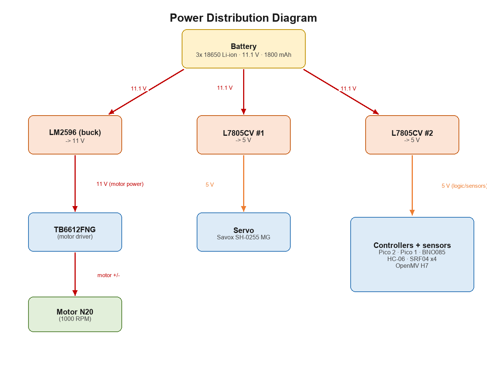

Separating the motor rail from the logic rail was a direct consequence of a problem we hit early on: motor switching noise was coupling into the encoder signal (see §4 and §5). The full wiring diagram is in `schemes/`.

### 3.2 Power budget

Estimated current draw per component (datasheet values):

| Component | Voltage | Typical current |
|-----------|---------|-----------------|
| N20 motor (driving) | 11 V | ~200 mA (0.3 A rated, 0.9 A stall) |
| Servo Savox SH-0255 MG | 5 V | ~150 mA (up to ~750 mA stall) |
| Pico 2 (main) | 5 V | ~60 mA |
| Pico 1 (sonar) | 5 V | ~40 mA |
| BNO085 | 3.3 V | ~4 mA |
| HC-06 | 5 V | ~30 mA |
| 4× SRF04 | 5 V | ~15 mA total |
| OpenMV H7 | 5 V | ~200 mA |

Per rail:

| Rail | Current | Power (at load) |
|------|---------|-----------------|
| Motor (11 V, LM2596) | 200 mA | ~2.2 W |
| Servo (5 V, L7805CV #1) | 150 mA | ~0.75 W |
| Logic/sensors (5 V, L7805CV #2) | ~350 mA | ~1.75 W |
| **Total (at load)** | | **~4.7 W** |

Power drawn from the battery (including regulator losses):

- **LM2596** (buck, ~85% efficiency): 2.2 / 0.85 ≈ **2.6 W**
- **L7805CV ×2** (linear, 11 V → 5 V): (0.15 + 0.35 A) × 11 V ≈ **5.5 W**
- **Total ≈ 8.1 W** (average)

**Battery and runtime:**

- Battery: 3× 18650 = 11.1 V × 1800 mAh = **20 Wh**
- Theoretical runtime: 20 / 8.1 ≈ **~2.5 h**
- Practical runtime (with start-up peaks and margins): **~1.5–2 h**
- Peak (stall): motor 0.9 A + servo 0.75 A → up to **~20 W** (brief)

The two L7805CV linear regulators waste ~55% of the input power as heat (11 V → 5 V); they dominate the battery draw. The servo rail is the worst case: at the servo's stall current (750 mA) the L7805CV would dissipate (11.1 − 5) × 0.75 ≈ 4.6 W in a TO-220 package without a heatsink, which would overheat. A buck converter (like the LM2596 already used for the motor) would be more efficient and would roughly double the runtime — a documented improvement for the next revision.

### 3.3 Sensors — selection and placement

| Sensor | Model | Role | Why this one |
|--------|-------|------|--------------|
| IMU | **BNO085** | heading | fused **game rotation vector** without a magnetometer — immune to the magnetic fields that made last year's CMPS12 compass unusable (see §3.5) |
| Distance | **4× SRF04 ultrasonic** (front, rear, left, right) | wall/obstacle distance | cheap, simple, sufficient range for the field |
| Camera | **OpenMV H7 R1** | traffic-sign colour detection | boots instantly, onboard colour detection, streams detections over UART (replaced a Raspberry Pi Zero + Pi Camera, whose boot was too slow) |
| Encoder | **quadrature encoder on the N20 motor** | odometry (distance) | provides the distance travelled |

**Placement:** the four sonars point forward, backward, left and right; the IMU is mounted on the chassis so its axes align with the vehicle.

**Camera placement.** The OpenMV is mounted **forward, 10.18 cm above the floor, with the optical axis pitched 8.3° below horizontal**. The height is the parking-measurement height (below the track wall, §2.1), so the camera keeps the same sign in view across the whole approach. The 8.3° pitch keeps a 5 cm sign visible while it is being passed without losing the far end of the lane. The vertical focal is 315 px at QVGA (339 px lateral); the 10.18 cm height, the 8.3° pitch and the focals were solved from two bench points, and a 15 cm sign at 37 cm reads (y=37.4, h=15.0) while a 10 cm sign at 60 cm reads (y=57.5, h=10.4), both within ±2 cm.

**Sonar orientation:** the front, left and right sonars are mounted **vertically** — their wider field of view in the vertical plane gives more reliable readings while driving (we tested that vertical reads better than horizontal in motion). Only the **rear** sonar is horizontal, due to lack of space.

### 3.4 Calibration

- **Encoder** — the quadrature signal is debounced in software (a **dynamic debounce** whose window scales with speed) because the motor produces electrical noise (see §4).
- **IMU** — uses the game rotation vector, so no compass calibration is required; the yaw reference is set at the start of a run.
- **Sonar** — the four sensors are fired **concurrently** (one 10 µs trigger to all four, then four echoes measured in parallel) for throughput; `SonarSlave/debug.py` prints the concurrent and sequential distances side by side, so any cross-talk between sensors is visible (see §4).
- **Camera** — bench-calibrated against two points: a 15 cm sign at 37 cm reads (y=37.4, h=15.0) and a 10 cm sign at 60 cm reads (y=57.5, h=10.4). The focal (315 px vertical, 339 px lateral), the 10.18 cm height and the 8.3° pitch were solved from those points; a 32 cm point was rejected as geometrically incompatible with the other two.

### 3.5 Gyro evaluation

We compared two heading sensors:

| Sensor | Magnetometer | Drift per lap | Notes |
|--------|:------------:|--------------:|-------|
| CMPS12 | yes | ~0° | but on tracks with magnetic fields the heading can jump by ~40° within a single lap |
| BNO085 (game rotation vector) | no | ~1° | small, consistent drift; unaffected by magnetic fields |

The CMPS12 reads ~0° drift in a clean environment, but the competition track can contain magnetic fields that cause errors of up to ~40° in a single lap — unusable for navigation. The BNO085 drifts about 1° per lap, but that drift is small, consistent and immune to magnetic fields; the remaining drift is corrected by the sonar-based odometry corrections (§4.6).

---

## 4. Software Architecture & Obstacle Strategy

### 4.1 Overview — three boards

| Board | Firmware | Responsibility |
|-------|----------|----------------|
| Raspberry Pi Pico 2 (main) | `src/robot/` (MicroPython) | navigation, control, sensor fusion |
| Raspberry Pi Pico 1 (sonar) | `src/robot/SonarSlave/` | reads the 4 sonars, streams distances over UART |
| OpenMV H7 | `src/robot/Camera/` | detects red/green traffic signs, streams detections over UART |

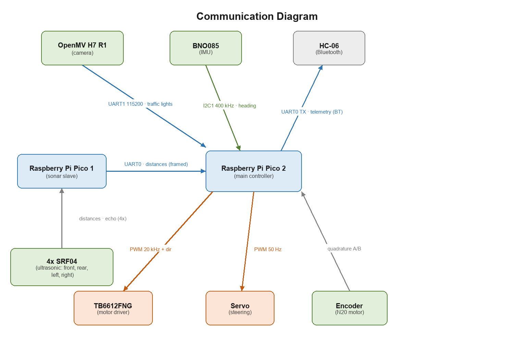

### 4.2 Main controller — modules

| Module | Responsibility |
|--------|----------------|
| `main.py` | entry point |
| `init.py` | hardware init (300 MHz clock, UARTs, camera, servo); starts the background thread |
| `obstacle_challenge.py` | the challenge **state machine** |
| `move_coordinates.py` | navigation primitives (move to a point, rotate) using odometry + PID |
| `background.py` | real-time control loop (sensors, odometry, cruise control, telemetry) |
| `state.py` | shared robot state (odometry, lane, direction) |
| `ekf.py` | Extended Kalman filter for pose (encoder predict + sonar update) |
| `field.py` | field model (lanes, zones, traffic signals) |
| `camera.py` | parses OpenMV traffic-sign detections |
| `distance.py` | parses sonar distances (framed protocol) |
| `encoder.py` | quadrature encoder with dynamic debounce |
| `motor.py` | motor PWM (20 kHz) and direction |
| `servo.py` | steering servo (50 Hz) |
| `compass.py` / `bno08x.py` | BNO085 heading |
| `pid.py` | PID controller |
| `telemetry.py` | telemetry over Bluetooth |
| `uart.py` | shared UART helper |

### 4.3 Concurrency — two cores

The main Pico runs two threads on its two cores:

- **Core 0** — the state machine (`obstacle_challenge`), which decides target speed and steering.
- **Core 1** — the `background` loop, which reads sensors at fixed rates (distance 50 Hz, camera 50 Hz, odometry 100 Hz, speed control 10 Hz) and drives the motor through the cruise controller.

We chose threads over `uasyncio` because, in our tests, the cooperative scheduler of `uasyncio` caused timing jitter in the driving loop that hurt the vehicle's behaviour. `_thread` on the RP2350 gives us two real cores, and the two threads communicate through a small shared state.

### 4.4 State machine (obstacle challenge)

The obstacle challenge is a state machine:

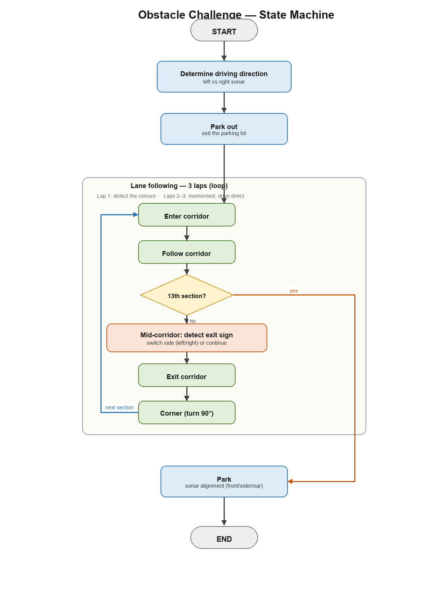

1. **Determine driving direction** — at the start, the robot compares the left and right sonar readings and picks clockwise or counter-clockwise accordingly.
2. **Park out** — it leaves the starting parking lot and aligns with the outer lane.
3. **Lane following — 3 laps** (the main loop, described below).
4. **Park** — it returns to the parking lot and parks parallel to the wall, using the sonars to align.

The state machine sets a target speed and a target heading; the low-level controllers (cruise control + PID) execute them.

**Lane following (the 3-lap loop):**

The field has four corridors (sections), and one lap = four sections. Inside each section the sequence is:

1. **Enter the corridor** — the robot first detects the entry traffic sign so that it enters on the correct side.
2. **Follow the corridor**.
3. **13th section?** — after 12 sections (3 laps), the robot exits to parking instead of continuing.
4. **Mid-corridor: detect the exit traffic sign** — the robot looks for the exit sign and decides whether to switch side (left ↔ right) or to continue straight.
5. **Exit the corridor**.
6. **Corner** — turn 90° into the next section.

The traffic sign is an obstacle pillar: the robot **adjusts its trajectory** according to the sign's colour — a **green** pillar is passed on the **left**, a **red** pillar on the **right**.

**Lap 1 vs laps 2–3:** the first lap is used to **detect and memorise** the colour of each sign. On the next two laps the positions are already known, so the robot drives **directly** without spending time re-detecting them.

### 4.5 Field model

The field is modelled in software as **4 lanes, each divided into 3 zones, each zone having 2 possible positions (left/right)** — matching the real WRO field layout. Each position holds a traffic signal in one of four states:

- **GREEN** / **RED** — a coloured pillar has been detected.
- **UNKNOWN** — not yet confirmed.
- **EMPTY** — confirmed to have no pillar.

To mark a position **EMPTY**, the camera must keep that position inside its field of view for a threshold time (2 s). This point-of-view accumulation guarantees the robot has looked at the position long enough before concluding there is nothing there — it avoids mistaking "I have not looked yet" for "there is nothing there".

### 4.6 Navigation and control

**Odometry** — the robot's position is estimated by an **Extended Kalman filter** (`ekf.py`, a 2D pose filter in centimetres). The heading stays on the BNO085 (game rotation vector, 100 Hz fusion) and is an input to the motion model:

- **Predict** — the encoder delta (`distance = counts / (PPR / gear_ratio) × wheel_circumference`) is integrated at 100 Hz, with process noise that grows with the distance travelled (encoder scale error along-track, a 2° heading error cross-track).
- **Update** — the sonar fixes at known locations are fused as Kalman updates in the lane-relative frame, one axis at a time, each gated by a Mahalanobis distance (3σ). A rejected fix leaves that axis untouched.

The filter keeps a covariance (`P`), so the correction strength adapts to the current uncertainty instead of snapping the position the way the old raw integration did.

**Line following** — `move_coordinates` drives the robot toward a target point. It projects the current position onto the target line and uses a **PID controller on the cross-track error** to steer, while a trapezoidal speed profile (constant speed, then deceleration near the target) controls the speed. `rotate_coordinates` / `rotate_angle` rotate the robot in place toward a point or a heading.

**Steering PID** — the cross-track error is corrected by a PID with gains `kp=0.35, ki=0.003, kd=0.5`, with the output clamped to the steering range.

**Cruise control** — an incremental speed controller (`kp=1/150`) converts the target speed into a motor PWM, with acceleration/deceleration limits (`max_accel=0.425`, `max_decel=2.25` of full PWM per second) and a `min_drive_pwm=0.15` floor that overcomes static friction. The acceleration is scaled down while steering (`accel_scale = 1.0 − 0.35·steering`) so the wheels do not scrub in corners. Before reversing, the controller holds the brake for `REVERSE_HOLD_MS` (500 ms) so the wheels really stop — reversing while still rolling makes them skid and corrupts the odometry.

**Sonar** — the sonar controller (Pico 1) streams the four distances over UART0 using a framed protocol (header `0xA5`, four little-endian `uint16` scaled ×10, XOR checksum), so a dropped byte cannot permanently desynchronise the receiver.

**Odometry correction** — the EKF's update step runs in the background loop at 40 Hz, but only where a wall reading is meaningful: `correct_corridor()` (driving straight along a corridor) and `correct_corner()` (rounding a corner). This keeps the position estimate anchored to the real walls, while the Mahalanobis gate rejects readings that disagree with the current estimate.

### 4.7 Traffic-sign detection and passing

The OpenMV runs a colour-blob detector, then converts each blob to the sign's **position and height in centimetres** in the camera frame, and streams one line per frame `CAM:x,y,h,COLOR` (x lateral + right, y forward, h sign height; `CAM:` when nothing is seen). The main controller:

1. turns each detection into an absolute field position — `x_field = x_camera + y·cos θ + x·sin θ` and `y_field = y_camera + y·sin θ − x·cos θ`, with θ the heading and the camera 10.5 cm ahead of the odometry origin — and keeps only detections **within 5 cm** of a known sign position;
2. records the colour in the field model (`Field.set_signal`) and accumulates the point-of-view time;
3. inverts the colour when the height says the sign is a modified 5 cm or 15 cm one (the Surprise Rule), so the passing side follows the original colour.

The state machine then reads the field model (`can_enter_lane`, `can_exit_lane`, `lanes_sides`) and **adjusts the trajectory** so the robot passes each pillar on the correct side (green left, red right).

### 4.8 Noise handling

The encoder signal is the most sensitive part of the system. The motor produces electrical noise that used to create spurious encoder counts. We addressed this on three levels (detailed in §5):

1. **PWM frequency** raised to **20 kHz** so switching noise is above the encoder band.
2. **Software debounce** on the encoder, made **dynamic** (scales with speed).
3. **Separation** of the motor power rail from the logic rail.

### 4.9 Testing, tuning and validation

- **Steering PID** — we learned how to tune the gains from a PID tuning video (https://youtu.be/4Y7zG48uHRo): start with proportional gain, add derivative to reduce overshoot, then integral to remove steady-state error.
- **Cruise control** — the acceleration/deceleration limits were chosen so the wheels **never slip**, because slipping corrupts the odometry.
- **Steering limits** — the maximum steering offset was set to the **largest value that does not strain the servo**.
- **Validation** — we validate with long runs (e.g. **10 consecutive laps**) and require them to never fail; we drive the robot to known coordinates and **measure** the reached position to confirm accuracy; and we measure the **final position error when running on odometry alone** (without the sonar corrections) to quantify the drift.

**Measured results** (firmware-in-the-loop simulator — seed `2026`, 24 signs, run 2026-11-11; the exact command is in `src/simulator/README.md`):

| Metric | Value |
| --- | --- |
| Odometry error vs ground truth | median **2.8 cm**, max per round **6.9 cm** (worst 9.5 cm); stationary median 2.4 cm, max 4.8 cm |
| Obstacle challenge score | **62/62** on several seeds; **40 of 53** sign layouts |
| Round time (on the car) | obstacle ~**150 s ± 10 s**, open ~**80 s ± 10 s** |
| Parking | **1.8.2** (complete and parallel) in all rounds that finish |
| Top speed | ~77 cm/s rated at the wheel (1000 RPM N20 + 3:5); run at 45–60 cm/s |
| IMU heading drift | ~1° per lap (BNO085 game rotation vector, §3.5) |

Every firmware change is judged by this table — score, lap time, odometry error and parking — so a change that does not improve a number does not go in. The finer bench metrics (PID step response, camera false-positive rate, sonar frame-loss) are method-ready: `debug_pid.py`, the camera's `RAW:` output and `SonarSlave/debug.py` already print the raw data they would be computed from, and are opened when a symptom points at them.

### 4.10 Simulator (firmware-in-the-loop) and validation

Rather than guessing whether a firmware change helps, we built a **firmware-in-the-loop simulator** so every change is scored by the same WRO 2026 table the judges use. Before it, a change was judged "feels better" after a few manual runs; now it is judged by its score, lap time, odometry error and wall/sign margin, on a reproducible track.

<div align="center">
    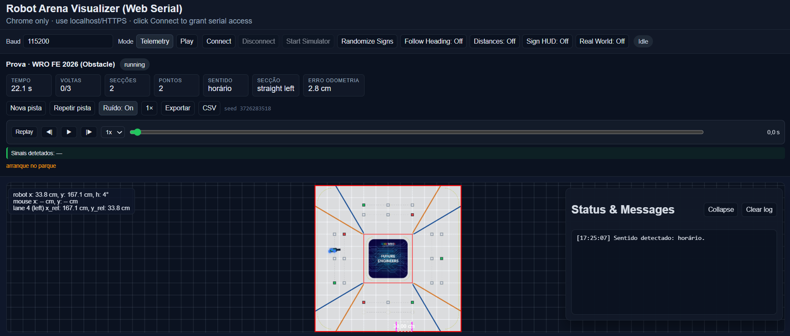
</div>

**Design decision — run the real firmware, not a reimplementation.** The simulator does not port the control code to Python; it runs the actual `src/robot/` MicroPython under CPython through a hardware shim that emulates the sonar frames, camera lines, encoder pulses and IMU heading. A bug fixed in `src/robot/` is fixed in the next simulated round with no porting step. A reimplementation would only prove a copy works — it would never prove the car works.

**Fidelity is measured, not assumed.** The "Erro odometria" tile compares the firmware's own `state.odom` against the world's true pose every frame; the median error is **2.8 cm** and the maximum per round **6.9 cm**. That number is the proof that the units, signs and coordinate frames are correct — exactly where such integrations usually fail silently.

**Reproducibility.** The seed fixes the sign layout and the start direction, and a run is a pure function of the world the firmware sees (lock-step physics: the world advances only when the firmware blocks in a sleep). Two firmware versions are therefore compared on the same track, at 1×/2×/4× speed.

**What it found.** The simulator has already caught real defects:
- a sign-convention contradiction between the odometry and the camera zones (the heading and the traffic table used opposite rotation conventions, so no IMU sign made both work);
- `os.environ` and `math.hypot`, which exist in CPython but not in MicroPython, and killed two rounds on the board (now caught before flashing by `src/simulator/tools/mpy_audit.py`);
- a steering-sign bug in the shim that looked exactly like "the firmware turns into the wall".

**Current measured results** (see `src/simulator/README.md`): the firmware scores **62/62** on several seeds and on **40 of 53** sign layouts, with the parking manoeuvre the most fragile part (it lands in 1.8.2 / 1.8.3 / zero depending on the draw).

### 4.11 Edge cases

- **Traffic sign not yet seen / ambiguous** — the robot keeps searching and re-confirming the sign until it is sure of its colour, or sure that the position is empty (point-of-view threshold).
- **Invalid sonar reading (−1)** — handled by the framed protocol and by ignoring out-of-range values in the correction logic.
- **Odometry drift** — corrected by the sonar-based `correct_corridor()` / `correct_corner()`.
- **Rotation / movement getting stuck** — every rotation and movement has a timeout, after which the robot stops and falls back.
- **UART desynchronisation** — the sonar and camera parsers re-synchronise on the header/line and drop garbage.

### 4.12 Open Challenge

The Open Challenge (no traffic signs, random start, 600 or 1000 mm corridors) has its own, much simpler controller (`open_challenge.py`) — deliberately: there is nothing to classify, only a loop to drive.

1. **Direction** — the car drives straight until the front sonar drops below 45 cm (a wall), turns to heading 0, then reads the left and right sonars: a wall closer than 90 cm on one side sets `state.clockwise` (+1 wall on the left, −1 on the right) and therefore the direction of the three-lap loop.
2. **Pose** — the odometry is then set from the two side sonars, so the loop starts from a known corner instead of a boot pose.
3. **Loop** — it repeats `move_coordinates(247, 32)` twelve times (four corners × three laps) and finishes at `(150, 32)`; `move_coordinates` closes a heading and speed loop on the odometry the EKF maintains in the background.

It is a **waypoint loop, not a state machine**, because the Open Challenge has no decisions to make: the same four corners are driven three times. It shares the EKF, the cruise controller and the steering loop with the obstacle challenge, so a fix in those layers helps both runs.

---

## 5. Systems Thinking & Engineering Decisions

This section records the constraints, trade-offs and iterations that shaped the design.

### 5.1 Constraints

- **Power** — a single 11.1 V battery must supply the motor, servo and all electronics.
- **Size** — the vehicle must fit in 300×200×300 mm.
- **Processing** — the main controller is a Pico 2; heavy vision is offloaded to the OpenMV.
- **Magnetic fields** — the competition environment can contain magnetic fields, so we avoid magnetometer-based heading.

### 5.2 Key trade-offs and decisions

**1. Threads (`_thread`) vs `uasyncio`**
We first migrated the control loop to `uasyncio` for cleaner code, but the cooperative scheduler introduced timing jitter that degraded the driving. We **reverted to `_thread`** (two real cores), accepting the extra care needed for shared state in exchange for deterministic timing.

**2. Sonar firing — concurrent, with a cross-talk check**
We fire all four sonars **concurrently** — one 10 µs trigger to all four, then measure the four echoes in parallel — because it keeps the update rate high. Concurrent firing risks **cross-talk** (one sensor's echo picked up by another), so `SonarSlave/debug.py` prints the concurrent and sequential distances side by side and flags where they disagree.

**3. Encoder debounce — fixed vs dynamic**
A fixed debounce could not handle both fast and slow speeds: at low speed the real edges are sparse and the noise dominates. We implemented a **dynamic debounce** whose window scales with the current speed, and we also raised the **PWM to 20 kHz** to move the noise source above the encoder band. These two changes together fixed the encoder over-counting.

**4. Cruise-control reversal guard (brake hold)**
Reversing the motor while the wheels are still rolling makes them skid, and the encoder then counts wheel spin that does not translate into travel, corrupting the odometry. We added a **guard** that, when the target speed and the current speed have opposite signs, holds the brake for `REVERSE_HOLD_MS` (500 ms) before the motor actually reverses.

**5. Motor and gearing choice**
We chose a **1000 RPM N20 with a 3:5 reduction** so the wheel turns at 600 RPM — enough top speed (~100 cm/s theoretical) while keeping torque reserve, and we run well below the maximum (45–60 cm/s) for control stability.

**6. Front nose and the parking-length rule**
We originally kept the front raised above the field walls so it would pass over low obstacles. A rule clarification then stated that the parking length is measured at the height below the track wall (10 cm), so we added a **nose close to the ground** at the front. This keeps the measured length at 20 cm, which entitles the robot to a 30 cm parking bay. This is a mechanical decision, described in §2.1.

**7. Heading sensor — CMPS12 → BNO085**
Last year we used a CMPS12 compass module, but the magnetic fields in the competition environment made the heading unreliable. We switched to the **BNO085**, which uses a fused game rotation vector without a magnetometer, giving a stable heading that is unaffected by magnetic interference.

**8. Vision — Raspberry Pi Zero + Pi Camera → OpenMV**
Last year we used a Raspberry Pi Zero with a Pi Camera, but its Linux boot time before each run was too long. We switched to the **OpenMV H7**, which boots instantly and runs the colour detection onboard, streaming only the detections over UART.

**9. Distance sensing — ultrasonic vs LiDAR/IR**
We chose **ultrasonic (SRF04)** over LiDAR or IR distance sensors because we cannot know the reflectivity and colour of the competition walls in advance — LiDAR and IR depend on those surface properties, so their readings can vary with the wall. Ultrasonic is less accurate, but its measurements are more **consistent across different wall conditions**, which matters more for reliable driving.

**10. Steering servo — SG90 → Savox SH-0255 MG**
We first used a micro 9g SG90 servo; its gears broke — both the plastic-gear and the metal-gear versions — under the steering load. We did not run a measured lifetime test on the SG90: the failure was the trigger, and we switched to the **Savox SH-0255 MG** (metal gears, less play), which has held up since.

### 5.3 Iteration history

The development is recorded in the git history (169 commits at the time of writing). Key iterations, aligned with the real commits:

| Change | Trigger / problem | Commit |
|--------|-------------------|--------|
| baseline drive + encoder | first running prototype | initial commits |
| `uasyncio` control loop | cleaner code | `7a2725a` |
| revert to `_thread` | `uasyncio` scheduling jitter degraded driving | `153aaeb` |
| concurrent sonar firing + debug tool | throughput; cross-talk check | `13910c0` |
| 20 kHz motor PWM | encoder over-counting from motor noise | `40c1fe2` |
| dynamic encoder debounce | noise dominates at low speed | `9d59c39` |
| cruise-control reversal guard | motor reversing during deceleration | `f966934` |

Each change is a measured fix: the trigger (jitter, cross-talk, over-counting, reversal) was observed first, and the change resolved it.

### 5.4 Risk & failure analysis

| Failure mode | Effect | Mitigation |
|--------------|--------|------------|
| Encoder noise (motor) | wrong odometry | 20 kHz PWM, dynamic debounce, separated power rails |
| Sonar cross-talk | wrong distances | concurrent firing + `SonarSlave/debug.py` comparison |
| Motor reversing on deceleration | wrong direction | cruise-control guard |
| Traffic-sign misdetection | wrong passing side | colour thresholds + region filtering on OpenMV |
| UART desync (sonar) | corrupted distances | framed protocol with header + checksum |

---

## 6. Reproducibility & GitHub

The repository is structured so another team can rebuild the vehicle:

- `README.md` — system description (English, ≥5000 chars), module responsibilities and build/upload steps.
- `models/` — CAD and 3D-printable files.
- `schemes/` — wiring diagrams (communication and power).
- `other/img/` — the obstacle-challenge state machine flowchart.
- `src/robot/` — all control software (main, sonar slave, camera firmware).
- `t-photos/`, `v-photos/`, `video/` — team/vehicle photos and driving video.

The commit history shows the development over time, and the README plus code comments document how to flash each board.

---

## 7. To be completed

### Compliance (team)

1. **Bluetooth (debug only)** — the HC-06 is used only for debugging and is physically removed during competition rounds; the telemetry path is disabled for rounds (rule 11.10).
2. **Start button** — add a start button (rules 9.10–9.11) and document the single power switch.
3. **Weight** — done: measured **610 g** (limit 1.5 kg, rule 11.2); recorded in §2.1.
4. **English** — done: the code (robot and simulator) is fully in English.

### Artefacts (team)

5. Driving video (`video/`) — done: obstacle and open challenge links.
6. CAD files in `models/` — done: 27 parts, each in STEP and STL.

### Measurements to publish (from test runs)

7. Test metrics — partly done: score (62/62), round time and odometry error (median 2.8 cm) are recorded in §4.9; cross-track error and drift-per-lap still to publish.
8. PID tuning data (overshoot vs steady-state, or step response) — to measure.
9. Camera colour-threshold false-positive rates (red vs green, different lighting) — to measure.
10. Sonar protocol frame-loss rate — to measure.
11. IMU heading drift — done: ~1° per lap (§3.5); drift in °/min still to measure.
12. Measured top speed under load — to measure (rated ~77 cm/s, §2.4).

### Open Challenge

13. The Open Challenge (`open_challenge.py`) is currently a set of hard-coded waypoints and is not called by `main.py`. It must be completed (handle the 600 mm vs 1000 mm corridors and the random start position), or its strategy documented honestly as work in progress.
